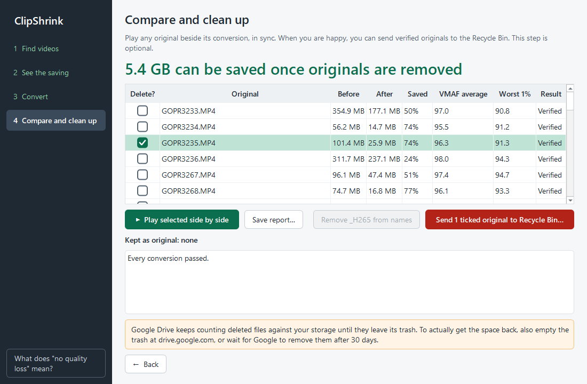
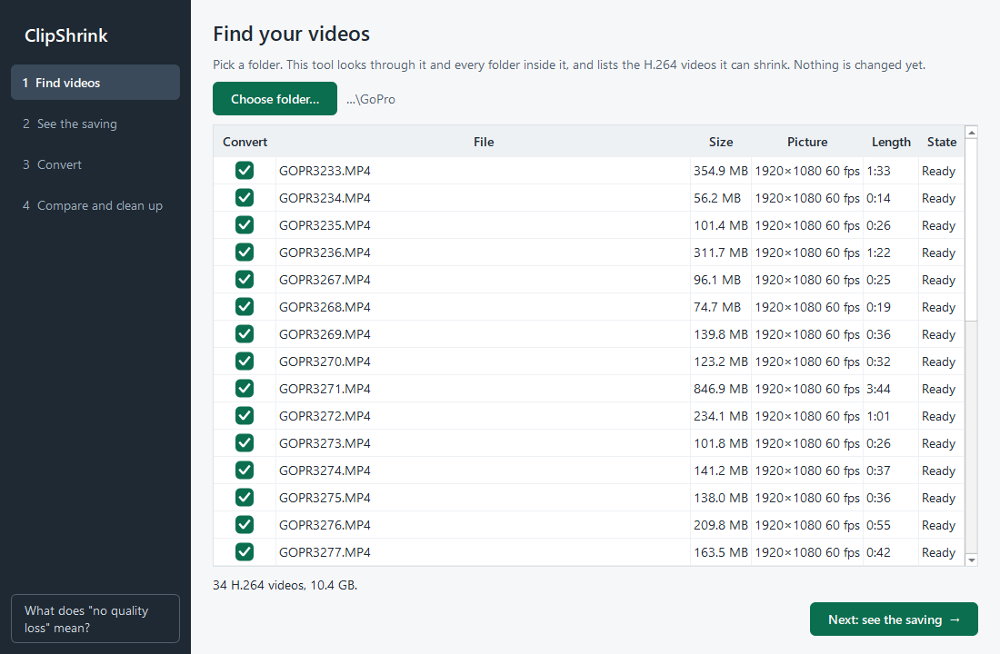
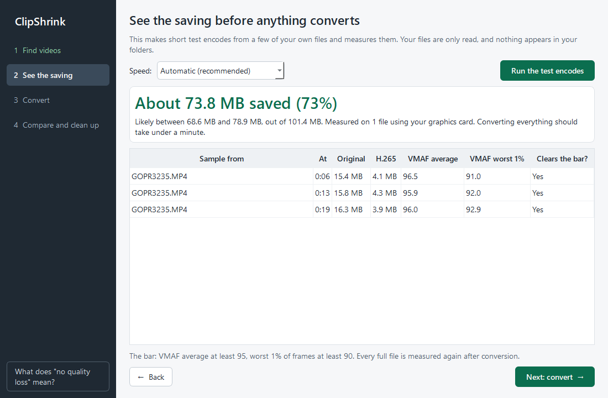
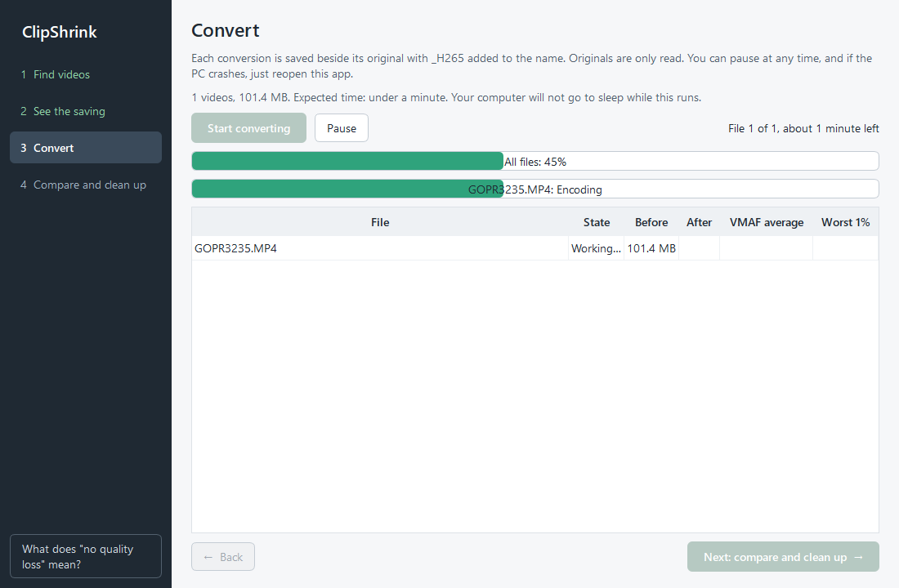

# ClipShrink

[](https://github.com/tophe323/ClipShrink/actions/workflows/tests.yml)
[](https://github.com/tophe323/ClipShrink/releases/latest)
[](LICENSE)

**Shrink your videos to free up disk space, without visible quality loss, and prove each one still looks the same.**

ClipShrink is a Windows app that batch converts H.264 videos to H.265. It works on any H.264 video and takes special care of GoPro files, keeping their telemetry. Every conversion is compared with its original, frame by frame, before it is accepted. If a file doesn't pass or isn't smaller, you keep the original and the app tells you.



*Screenshots show real GoPro footage. The find and compare pages show one real 34-clip batch, redrawn from its saved results. The saving and convert pages show a run on one clip from it.*

## Download

**[Download ClipShrink-Setup.exe](https://github.com/tophe323/ClipShrink/releases/latest)** (about 160 MB) for Windows 10 or 11, 64-bit.

Run it and it installs. There's no administrator password and nothing else to install.

The installer isn't code-signed yet, so Windows may show "Windows protected your PC". To continue, click **More info**, then **Run anyway**. Each release lists a SHA-256 checksum if you want to check your download first.

## Real results

On one batch of 34 real 1080p GoPro clips, using an NVIDIA graphics card:

| | |
|---|---|
| Before | 10.41 GB |
| After | 4.99 GB |
| Saved | 5.42 GB (52%) |
| Clips that passed | 34 of 34 |
| Lowest VMAF average | 95.5 (required: 95) |
| Lowest worst-1% score | 90.3 (required: 90) |

Individual clips saved between 9% and 77%. Your results will depend on your footage, so the app measures your own files before you commit.

## How to use it

### 1. Find your videos
Pick a folder. ClipShrink looks through it and every folder inside it, and lists every H.264 video. Videos that are already H.265 are shown as skipped.



### 2. See the saving
Before anything converts, the app makes short test encodes from your own files and shows the expected saving and time.



### 3. Convert
Each conversion is saved beside its original with `_H265` added to the name. You can pause at any time. If your PC crashes, reopen the app and it continues, skipping finished files.



### 4. Compare and clean up
Play any original beside its conversion, in sync, with frame stepping and a 100% zoom. Left is the original and right is the conversion.


When you're happy, you can send verified originals to the Recycle Bin, then remove `_H265` from the new names. Both steps are optional and ask you to confirm.

> **Videos in Google Drive?** It keeps counting deleted files against your storage until they leave its trash. To get the space back, also empty the trash at [drive.google.com](https://drive.google.com), or wait for Google to remove them after 30 days.

## What "no quality loss" means here

Truly lossless H.265, where every pixel stays identical, usually makes files **larger** than the originals. So ClipShrink uses a measured definition instead.

It scores every frame with [VMAF](https://github.com/Netflix/vmaf), Netflix's open measure of how video looks to people, from 0 to 100. A conversion is accepted only if:

- the **average** score is at least **95**
- the **worst 1% of frames** score at least **90**

That's a measurement, not a mathematical guarantee. Use the side by side player if you want to judge a clip with your own eyes.

## What it keeps

- **Sound, GoPro telemetry, timecode and camera info, where present:** copied byte for byte, and checked afterwards.
- **Resolution, frame count, frame rate and duration:** checked against the original.
- **Capture dates:** both the date inside the file and the file's created and modified dates.
- **Your originals:** only read during conversion. Deleting is a separate step, offered only for verified files, and goes to the Recycle Bin.

## Limitations

- **Windows only**, with one file converted at a time.
- **File types:** full conversions have been tested on MP4 files. MOV, MKV and others are found by the scan, but conversions of them haven't been tested yet.
- **Real-world testing so far:** one person's GoPro footage, plus generated test clips.
- **Speed:** NVIDIA graphics cards are used automatically and are much faster. Other PCs use the processor.
- **Telemetry:** tested on generated tracks in GoPro's format and on a HERO3-era clip, which has no telemetry track. It hasn't yet been tested on a real HERO5-or-later file with GPS data. Check a clip in your own telemetry tool before deleting its original.
- **Google Drive for desktop:** the Recycle Bin hasn't been tested on a Drive-mounted `G:` drive. Try one small file first, and cancel if Windows warns about permanent deletion.
- **Very large files:** nothing over 4 GB has been tested yet, and 4K has only been tested on short clips.
- **Compatibility:** H.265 plays on most devices from about 2016 onwards, but some older ones can't play it.

Reports on any of these are very welcome.

## How it works

ClipShrink is a Python app that runs FFmpeg to encode and measure, mpv to play, and Qt to draw the window. FFmpeg can't write GoPro's data tracks into an MP4, so ClipShrink builds the final file itself: everything from the original, with only the video swapped.

Read the full explanation in **[How it works](docs/how-it-works.md)**.

## For developers

```bat
setup_dev.bat
check.bat
```

`check.bat` runs the full test suite, about 10 minutes, and needs a real GoPro clip in `tests/real_clip/`. Tests prove the quality bar on every conversion, using their own measurement code rather than the app's. See [CONTRIBUTING.md](CONTRIBUTING.md) and the [history of check runs](docs/test-history.md).

## Licence

[GPL-3.0](LICENSE). The installer bundles FFmpeg, x265, VMAF, mpv and Qt, listed in [THIRD_PARTY_NOTICES.md](THIRD_PARTY_NOTICES.md).

ClipShrink is an independent project, not affiliated with GoPro, Google, NVIDIA or Netflix. It comes with no warranty, so keep a backup of footage you can't replace.

Built with [Claude Code](https://claude.com/claude-code).
