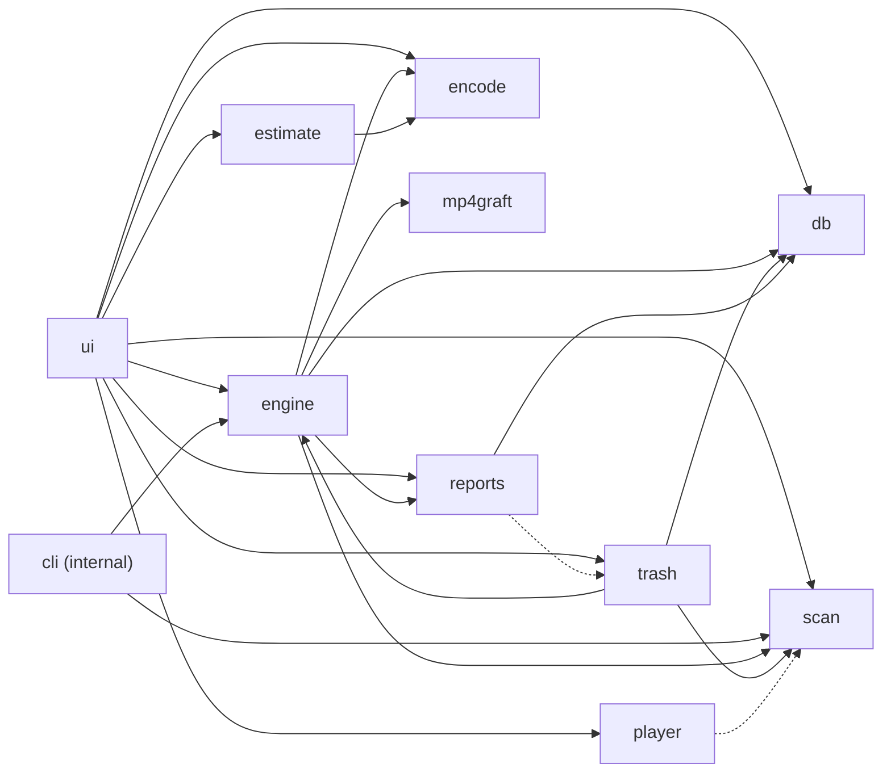

# Architecture

ClipShrink is a Python package, `clipshrink/`, with a Qt (PySide6) interface on top of an engine that drives FFmpeg and mpv. The interface follows the four stages the user sees: find, estimate, convert, compare and clean up.

## Module map

The diagram shows imports between the modules. Solid arrows point from the importing module to the imported one. The dashed arrows are imports made inside a function, not at the top of the file. `config` and `tools` are left out of the arrows because many modules use them (see the table).



## What each module does

| Module | Job |
| --- | --- |
| `ui.py` | The desktop interface. Four stages, left to right. |
| `scan.py` | Stage 1: walks a folder and its subfolders and lists every H.264 video. Uses `config` and `tools`. |
| `estimate.py` | Stage 2: measures expected savings by test-encoding samples of real files. Creates nothing beside the originals. Uses `config`. |
| `engine.py` | Stage 3: the batch. One file at a time: search, encode, build, verify, deliver. Originals are only read. Uses `config` and `tools`. |
| `encode.py` | FFmpeg commands: encode, measure VMAF, find the right quality setting. Uses `config` and `tools`. |
| `mp4graft.py` | Builds the final file: every box and track of the original, with only the H.264 video swapped for the new H.265 video. |
| `db.py` | The batch's memory (SQLite). Each state change is on disk before work moves on, which makes resume after a crash possible. |
| `player.py` | Stage 4: side by side playback. One mpv process decodes both files into a single picture. Uses `tools`. |
| `trash.py` | Stage 4: optional cleanup. Only originals with a checked conversion, only with confirmation, only to the Recycle Bin. |
| `reports.py` | Per-batch reports (CSV files), lifetime statistics, and exports. Uses `config`. |
| `tools.py` | Finds the bundled programs (FFmpeg, mpv) and runs them without console windows. Also keeps Windows awake during a batch. |
| `config.py` | Fixed rules of the tool: version, thresholds, output suffix. Not user settings. |
| `cli.py` | Internal headless batch, see below. |

For the reasoning behind these stages, see [How it works](../internals/index.md).

## Internal CLI

!!! note "Internal"
    `clipshrink/cli.py` is not a user feature and is not part of the app. It exists so the check can run a real batch in a separate process and kill it to test resume.

```powershell
.venv\Scripts\python.exe -m clipshrink.cli convert <folder> --db <path> --work <path>
```

`--db` and `--work` are required. `--encoder` is optional and defaults to `auto`. The command scans the folder, converts every H.264 file it finds, and prints a summary. `tests/test_resume.py` starts it with `subprocess` and kills the process tree.

## Runtime data

The database, work folder and reports live under the user's local application data. See [Settings and data](../user-guide/settings-and-data.md) for the exact locations and what each holds.

## Next steps

- [Testing](testing.md) for how these modules are checked.
- Source: [clipshrink/ on GitHub](https://github.com/tophe323/ClipShrink/tree/main/clipshrink).
