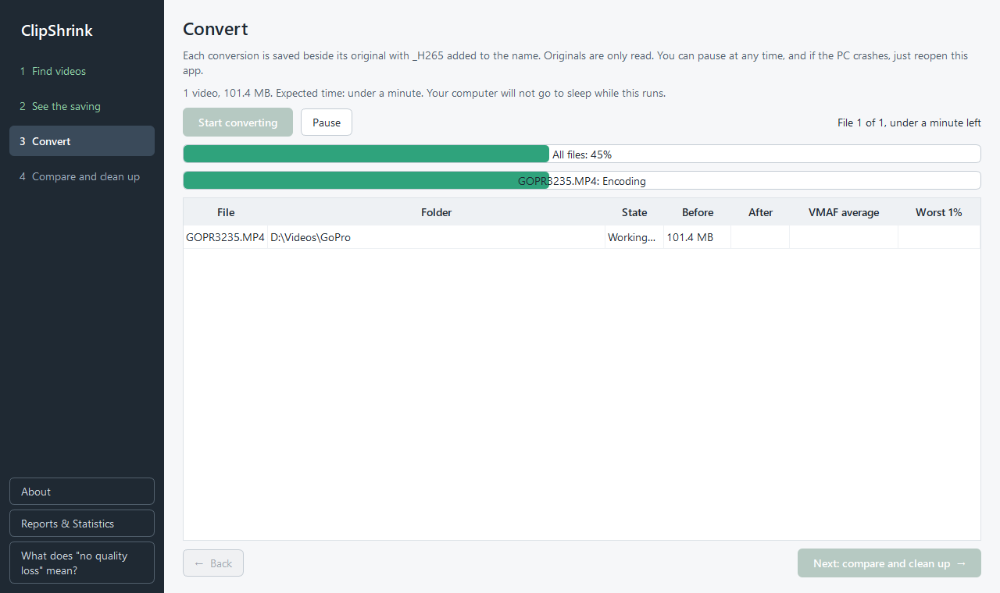
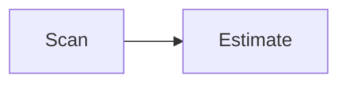

# Writing docs

How to add and edit pages on this site. The site is built with MkDocs Material from the `docs/` folder. For the preview commands see [Set up](setup.md#docs-site).

## Add a page

1. Create a `.md` file in the section folder, for example `docs/user-guide/my-topic.md`.
2. Add it to that folder's `.nav.yml` so it appears in the navigation.

Navigation order comes from the `.nav.yml` files (the awesome-nav plugin), not from a `nav:` block in `mkdocs.yml`. A page that is not listed in a `.nav.yml` still builds, but it is not in the menu.

```yaml
nav:
  - index.md
  - setup.md
  - my-topic.md
```

Every section folder has an `index.md` that opens the section. Start each page with exactly one `# Title` line, then use `##` and `###` headings in order.

`docs/how-it-works.md` is a short pointer page kept because the README links to it. It is not in the navigation. `docs/check_history.md` is excluded from the site.

## Links

Link to other pages with relative `.md` links. Link to code, tests and other repository files with absolute GitHub URLs, because relative links to files outside `docs/` break the build.

```markdown
See [Quality](../internals/quality.md) for the bar.
The check is in [check.py](https://github.com/tophe323/ClipShrink/blob/main/check.py).
```

Check your work with `mkdocs build --strict`. The Docs workflow (`.github/workflows/docs.yml`) runs the same command on pull requests that change `docs/`, `mkdocs.yml` or `requirements-docs.txt`.

## Markdown extensions

These extensions are enabled in `mkdocs.yml`. Each example below is the source you type.

### Admonitions

````markdown
!!! warning "Title"
    Indented text belongs to the box. Types include note, tip, warning.
````

### Collapsible blocks

````markdown
??? note "Optional detail"
    Hidden until the reader opens it. Use `???+` to start open.
````

### Attribute lists

````markdown
[Download](https://example.com){ .md-button }

{ width="600" }
````

### Definition lists

````markdown
Term
:   Definition of the term.
````

### Markdown inside HTML

````markdown
<div markdown="1">

Text here is still **parsed as Markdown**.

</div>
````

### Tables

````markdown
| Column | Meaning |
| --- | --- |
| `a` | First |
| `b` | Second |
````

### Task lists

````markdown
- [x] Done
- [ ] Still to do
````

### Code blocks

Always give a language. A copy button is added automatically.

`````markdown
```powershell
mkdocs serve
```
`````

### Mermaid diagrams

Use a `mermaid` fence. Quote labels that contain special characters.

`````markdown

`````

## Images

Put images in `docs/images/` and give them meaningful alt text. Use real screenshots only.

## Next steps

- [Contributing](contributing.md) for the project rules.
- [Architecture](architecture.md) if the page documents code.
