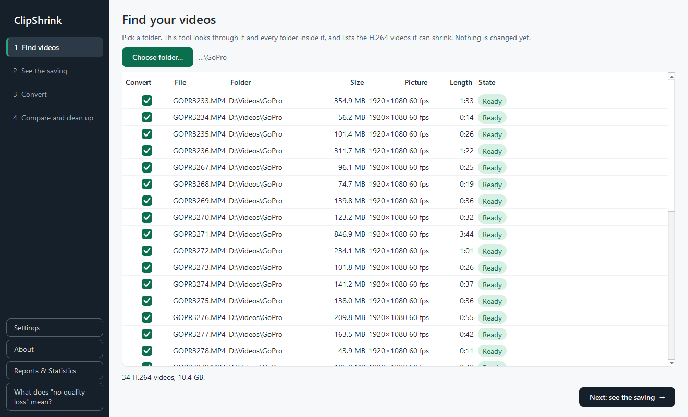
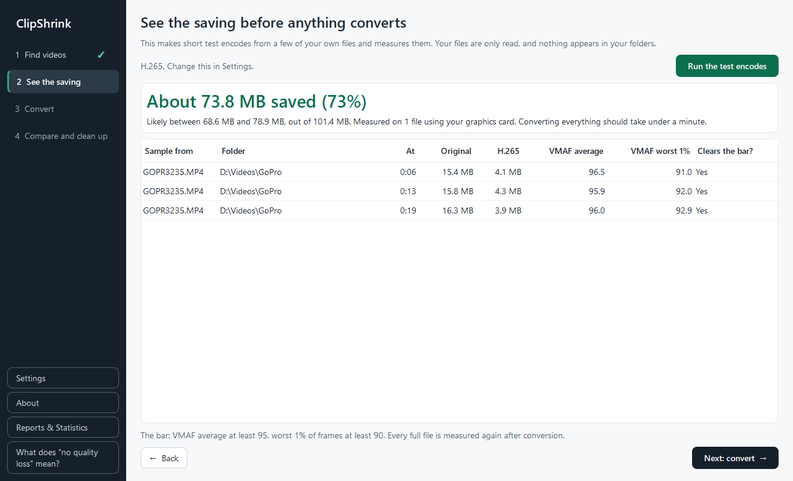
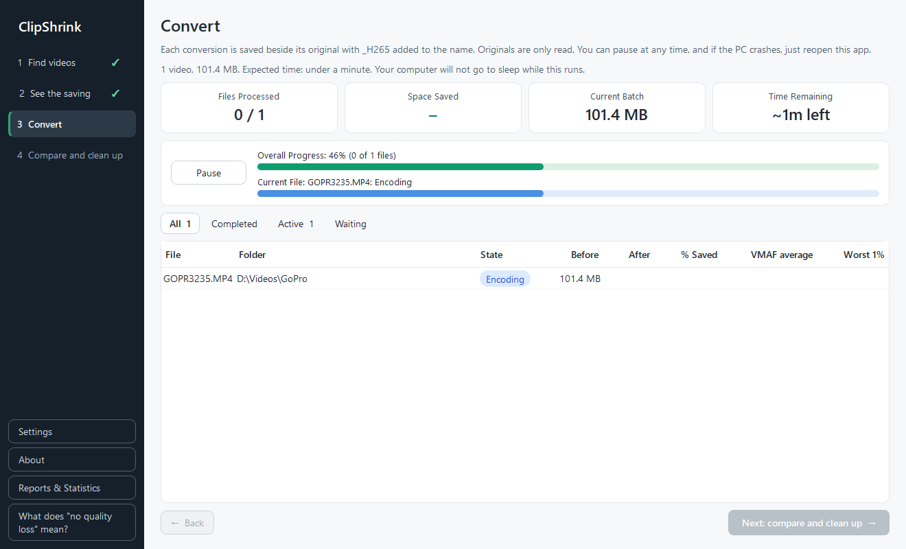
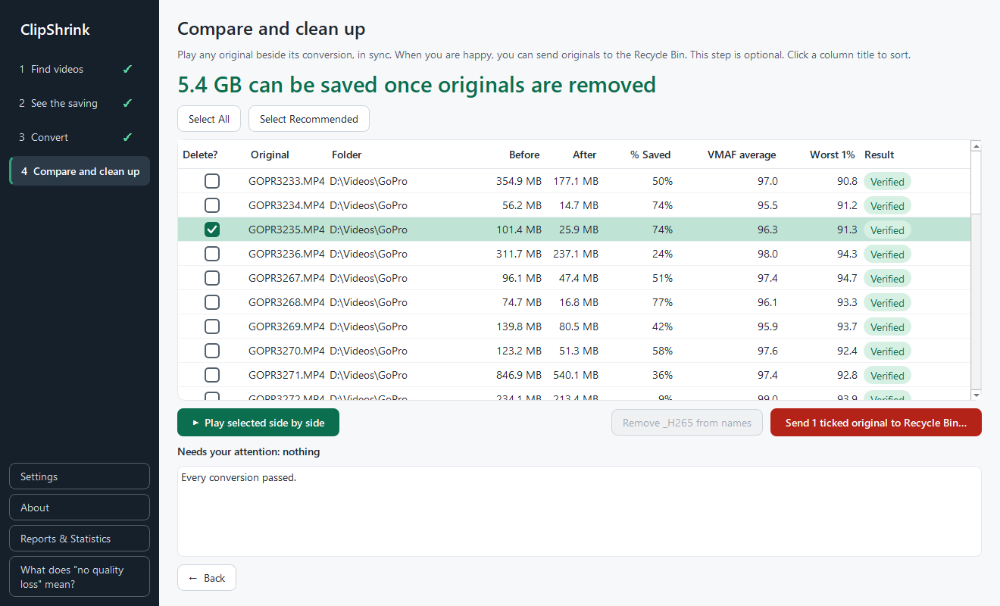
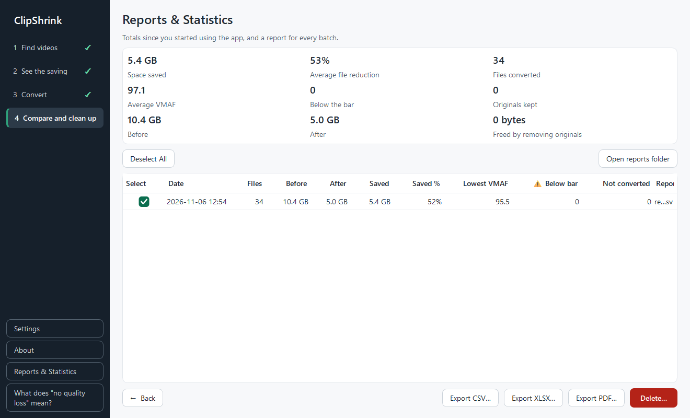

# Your first batch

ClipShrink walks you through four numbered steps, plus a **Reports & Statistics** page. This is a short tour; each section links to the page that explains it fully.

## 1. Find videos

Click **Choose folder…**. ClipShrink looks through the folder and every folder inside it and lists the H.264 videos it can shrink. Nothing is changed yet.

More in [Finding videos](../user-guide/finding-videos.md).

## 2. See the saving

Click **Run the test encodes**. The app converts short pieces of a few of your own files as a trial and shows the expected saving and time. Your files are only read.

More in [Estimates](../user-guide/estimates.md).

## 3. Convert

Click **Start converting**. Each conversion is saved beside its original with `_H265` added to the name (`_AV1` if you chose AV1 in [Settings](../user-guide/settings-and-data.md)). You can pause at any time, and if the PC crashes, reopen the app to continue.

More in [Converting](../user-guide/converting.md).

## 4. Compare and clean up

Play any original beside its conversion, in sync. When you are happy, you can optionally send originals to the Recycle Bin. This step is optional.

!!! warning
    Only send an original to the Recycle Bin after you are satisfied with its conversion, especially for files that carry a warning sign.

More in [Compare and clean up](../user-guide/compare-and-clean-up.md).

## Reports & Statistics

Every batch keeps its own report automatically. The **Reports & Statistics** page shows your totals and lets you export or delete reports.

More in [Reports](../user-guide/reports.md).

## Next steps

Read the [User guide](../user-guide/index.md) for the full detail of each page, or [Warnings and messages](../user-guide/warnings.md) if the app shows something you do not recognise.
