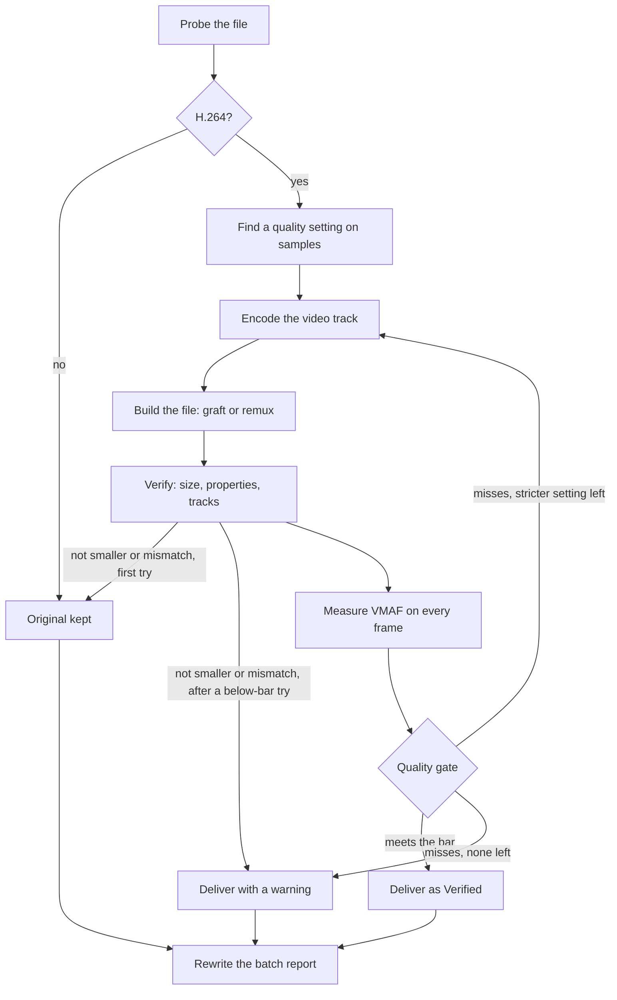

# How it works

ClipShrink is a Python desktop app that drives three bundled programs: **FFmpeg** encodes and measures, **mpv** plays, and **Qt (PySide6)** draws the window. Work happens in four stages, and the app never removes an original without your confirmation.

## The four stages

### 1. Scan

The scan walks the folder and every subfolder. It does not enter the Recycle Bin, `System Volume Information`, or Google Drive's temporary folders (`.tmp.drivedownload`, `.tmp.driveupload`). `ffprobe`, FFmpeg's file inspector, reads each video's codec, resolution, frame rate and length. Only H.264 videos are candidates. Files in another codec are listed as skipped, and files that cannot be read are mentioned in the scan summary instead of being hidden.

### 2. Estimate

The estimate test-encodes samples of up to 5 files and scales the measured result to your selection. See [Estimation](estimation.md).

### 3. Convert

Files are converted one at a time. Each file goes through the pipeline below.

### 4. Compare and clean up

One mpv process decodes the original and the conversion and joins them into a single picture, so both sides share one clock. Originals can then be sent to the Recycle Bin after a re-check. See [Safety](safety.md).

## The pipeline for one file

Step by step:

1. **Probe.** A file that is not H.264 is left alone and reported.
2. **Find the quality setting.** A binary search on short samples finds the loosest setting whose samples clear the bar by a margin. See [Quality](quality.md).
3. **Encode.** FFmpeg encodes the video track only, keeping every frame timestamp.
4. **Build the file.** For `.mp4`, `.mov`, `.m4v` and `.lrv` files, ClipShrink's own writer swaps the video into the original's structure. Other containers (file formats) are remuxed by FFmpeg, meaning repackaged without re-encoding. See [GoPro data](gopro-data.md).
5. **Verify.** The result must be smaller and match the original's properties, and a full-file VMAF comparison scores it. A result that misses the quality bar is retried at stricter settings; if none clears it, the best attempt is delivered with a warning.
6. **Deliver.** A verified file (or the best below-bar attempt, with a warning) is copied beside the original as `<name>_H265` (or `_AV1`) plus `.mp4`, `.mov` or `.m4v` as in the original (an `.lrv` becomes `.mp4`, other containers become `.mkv`), through a `.part` file, and given the original's dates.
7. **Report.** The batch's CSV report is rewritten after every file, so a crash keeps the record of everything finished.

Progress for one file is weighted 15% search, 55% encode and 30% verify. For the code layout see [Architecture](../development/architecture.md).

## Encoders

NVIDIA's hardware encoder NVENC is the default when a short test encode succeeds: `hevc_nvenc` for H.265 and `av1_nvenc` for AV1. For AV1, the software encoder is SVT-AV1, on preset 6. Otherwise ClipShrink uses x265, the software H.265 encoder, on the processor. Each encoder has its own list of 9 quality settings, tried from smallest file to best quality. There is no automatic switch from NVENC to x265 in the middle of a batch: an encoder error marks that file as failed and the original is kept.

NVENC has one trap, and it differs by format. For H.265, without a high `-maxrate`, it limits itself to around 25 Mbit/s and ignores its quality setting, so ClipShrink sets the cap to 800 Mbit/s. For AV1, a high `-maxrate` makes it ignore the quality setting and write huge files on some footage, so ClipShrink sets no cap. The cause of either hasn't been established; both were seen in measurements.

## Reports

Each batch writes a CSV report once its first file is finished; XLSX and PDF exports are made from that file on demand. Statistics come from the state database rather than the reports, so deleting a report does not change your totals. Values that start with `=`, `+`, `-` or `@` get a leading apostrophe so a file name cannot act as a spreadsheet formula. File locations and columns are in [Reports & Statistics](../user-guide/reports.md).

## Next steps

- [How quality is measured and decided](quality.md)
- [How the saving estimate is made](estimation.md)
- [Pause, resume and crash recovery](resume.md)
- [GoPro data and metadata](gopro-data.md)
- [How your files stay safe](safety.md)
