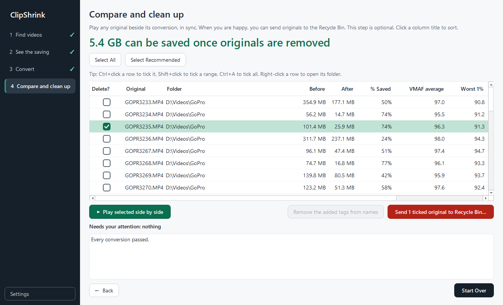

# Compare and clean up

After a batch finishes, step 4 lets you check each conversion against its original, then optionally send the originals to the Recycle Bin and tidy the file names. Both clean-up steps are optional.

The list shows the videos from the batch you just ran. The columns are: **Delete?**, **Original**, **Folder**, **Before**, **After**, **% Saved**, **VMAF average**, **Worst 1%** and **Result**, plus **Encoding** if you turned it on in [Settings](settings-and-data.md#encoding-column). Click a column title to sort, and drag the edge of a title to resize the column. Hover over **VMAF average** or **Worst 1%** for a short explanation. Right-click a row and choose **Open file location** to open its folder in Explorer, with the file highlighted. Once an original is in the Recycle Bin, this shows its conversion instead. A big label above the list tells you how much space can be saved once the originals are removed.

A "Needs your attention" box lists every file that was kept as the original, failed, or got a warning sign, with the reason. If all went well it says "Every conversion passed." [Warnings and messages](warnings.md) explains each result.

## Compare in the side-by-side player

1. Click a row in the list.
2. Click **Play selected side by side**.

The original (H.264) plays on the left and the conversion (H.265 or AV1) on the right, in sync. If the conversion was shrunk, the original is shrunk to match, so the two can sit side by side. The player starts by itself. Press the space bar to pause and resume, whichever button is highlighted. It has **Play/Pause**, **◀ Frame** and **Frame ▶** step buttons, a progress bar and a time label, and it shows the file's VMAF scores. Click anywhere on the progress bar to jump there, or drag its handle.

Four buttons choose how much you see:

| Button | What it shows |
| --- | --- |
| **Whole picture** | The full frame of both files. This is where the player starts. |
| **100%** | A window of each picture at 1:1, up to 960 by 1080 pixels per side, so you can judge fine detail such as grass, text or water. |
| **200%** | A smaller window, with each video pixel shown as a 2 by 2 block. |
| **400%** | A smaller window still, with each pixel as a 4 by 4 block. Edges look blocky on purpose, so compression blur is easy to spot. |

At 100%, 200% and 400%, drag the picture to look around. Both sides move together, so they always show the same spot. The zoomed view starts in the middle of the picture.

You can only compare a file whose conversion is verified or has a warning sign, and only while both the original and the conversion are still on disk. After you send an original to the Recycle Bin you can no longer play the pair.

## Choose what to delete

Only files that can be safely removed get a tick box: those with the result "Verified", "Resized" or "⚠ Below target". Other rows show a dash.

**Select All**
:   Ticks every file that has a tick box, including those with a warning sign.

**Select Recommended**
:   Ticks only files that cleared the quality target. Anything with a warning sign is left out.

Both buttons toggle: they change to **Deselect All** and **Deselect Recommended** once used. See [the quality target](../internals/quality.md) for what "recommended" means.

You can also tick rows yourself, much as you select files in Explorer:

| Action | What it does |
| --- | --- |
| Click a tick box | Ticks or unticks that row. |
| **Ctrl**+click a row | Ticks or unticks that row, and leaves the others alone. |
| **Shift**+click a row | Ticks every row from the last one you clicked to this one. |
| **Ctrl+A** | Ticks every row that can be deleted, like **Select All**. |
| Plain click on a row | Picks the row for **Play selected side by side**. It doesn't change any tick. |

Rows that can't be deleted, which show a dash, are never ticked this way.

## Send originals to the Recycle Bin

!!! warning "Deleting originals"
    Once an original is gone from the Recycle Bin, it cannot be recovered. This matters most for files with a warning sign, whose quality was measured below the recommended bar. Keep a backup of footage you can't replace.

1. Tick the originals you want to remove.
2. Click the red button, labelled **Send N ticked originals to Recycle Bin…**.
3. Read the dialog "Send originals to the Recycle Bin?". Tick **I understand. Send these originals to the Recycle Bin.** The button **Send to Recycle Bin** stays disabled until you do. The default button is **Keep them**.

If any ticked file has a warning sign, the same dialog adds a paragraph telling you how many of them have a conversion below the recommended quality, and that the lost quality can't be recovered once the original has left the Recycle Bin. A second paragraph appears the same way for conversions at a lower resolution, because that detail is gone for good once the original leaves the Recycle Bin. It is one dialog with one tick box, not a second confirmation.

A progress bar shows "Re-checking and removing N of M". Before each original is removed, ClipShrink re-checks that the conversion is still the one it verified. If a check fails, that original is left where it is and listed with a reason. When it finishes, a box tells you how many originals were moved and lists any that were "Left in place". ClipShrink asks Windows to move originals to the Recycle Bin, so you can normally restore them from there. The checks are explained in [Safety](../internals/safety.md).

## Remove the added tags from the names (optional)

Conversions are saved beside the original with tags added to the name, such as `_(h265)` or `_(1080p)_(h265)`. After an original has gone to the Recycle Bin, you can give the conversion the original's name.

1. Click **Remove the added tags from names**. It is disabled until at least one original has been sent to the Recycle Bin, and then reads **Remove the added tags from N name(s)…**.
2. Answer **Yes** or **No** to the question "Remove the added tags from names?". Unlike deleting, this is a simple Yes/No question.

Only the name changes. A progress bar shows "Renaming". A rename never overwrites another file. If a file can't be renamed, it is skipped and listed under "Left as they are". If you later restore an original from the Recycle Bin, Windows will ask what to do about the same name.

## Start Over

When you are done, exit the app or click **Start Over**. Either way, ClipShrink forgets these files. **Start Over** also returns to an empty step 1. Neither touches your videos, and the [reports](reports.md) stay.

Originals can only be removed here for the batch you just ran, because that's when the app has checked their conversions. If you exit first, remove those originals yourself.

## If something fails

- **Conversion problems** do not stop the batch. A file whose conversion failed, was not smaller, or didn't match its original keeps its original untouched, and has no tick box here.
- **A delete is refused** for a file: the original stays where it is and the result box tells you why.
- **Windows can't move a file** to the Recycle Bin: the original is left in place, with the reason "Windows did not move it to the Recycle Bin, so it was left in place".

The full list of messages is in [Warnings and messages](warnings.md).

## Next steps

- [Reports](reports.md)
- [Warnings and messages](warnings.md)
