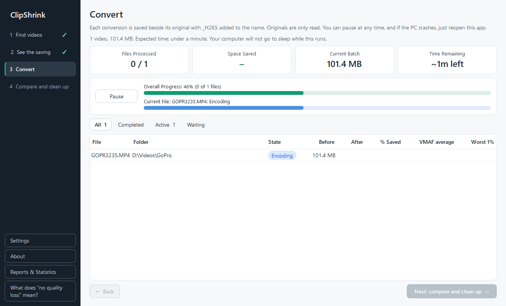

# Converting

Step 3 converts your videos one at a time, measures each one against its original, and keeps the results beside the originals.

## Start, pause, resume, stop

- **Start converting** begins the batch. The line above the button shows how many videos, their total size, and the expected time. While it runs, your computer will not go to sleep.
- **Pause** holds the work; the button becomes **Resume**. Pausing is not saved to disk, so it only lasts while the app stays open.
- **Stop**: there is no stop button. Closing the window while converting asks "Stop converting?" The file in progress is restarted next time, and finished files are kept.

Two progress bars show all files and the current file with its stage: "Finding the right quality", "Encoding", "Measuring every frame", then "Done". The table lists File, Folder, State, Before, After, VMAF average and Worst 1% for each video. When the batch ends, a line such as "Finished: 8 verified, ⚠ 1 below the bar" appears, and **Next: compare and clean up →** unlocks.

Videos are converted one at a time, never in parallel. A file that fails or is kept as original does not stop the rest of the batch.

## If your PC crashes

Reopen ClipShrink. It asks "Continue where you left off?" with the number of unfinished videos. Choose Yes to carry on; finished files are not redone. The file that was in progress starts again from the beginning. If you decline, the unfinished videos are offered again the next time you open the app.

Files that were already kept as original or failed are not retried on resume. How this works is described in [How resuming works](../internals/resume.md).

## Where the results go

Each conversion is saved next to its original with `_H265` added to the name, for example `Holiday.mp4` becomes `Holiday_H265.mp4`. If that name is taken, ClipShrink uses `Holiday_H265_2.mp4`, then `_3`, and so on. The original is only ever read.

| Original | Result |
| --- | --- |
| `.mp4`, `.mov`, `.m4v` | Same extension |
| `.lrv` (GoPro preview) | `.mp4` |
| `.mkv`, `.avi`, `.mts`, `.m2ts`, `.ts`, `.3gp` | `.mkv` |

The result gets the original's creation and modified dates.

While a file is being copied into place it has the extra ending `.part`, so a half-written file is never mistaken for a finished one. When the copy finishes, the file is renamed to its final name; a leftover `.part` file is deleted if you stop or after a crash. Everything else ClipShrink needs while working goes in its own folder, `%LOCALAPPDATA%\ClipShrink\work`, which is emptied afterwards. See [Settings and data](settings-and-data.md).

## Graphics card or processor

The **Encode with** setting decides whether your NVIDIA graphics card (fast) or your processor (slow, works on any PC) does the encoding; see [Settings and data](settings-and-data.md#encode-with). If the graphics card's encoder reports an error during a batch, that file fails and the original is kept; ClipShrink does not switch to the processor mid-batch.

## What can go wrong

For every file ClipShrink checks that the result is smaller, matches the original, and meets the quality bar. If not, the original is kept or the result is flagged with a warning. [Warnings](warnings.md) explains each case, and [How quality is checked](../internals/quality.md) explains why.

## Next steps

- [Compare and clean up](compare-and-clean-up.md) to play results beside the originals.
- [How resuming works](../internals/resume.md) and [How quality is checked](../internals/quality.md) for the details.
