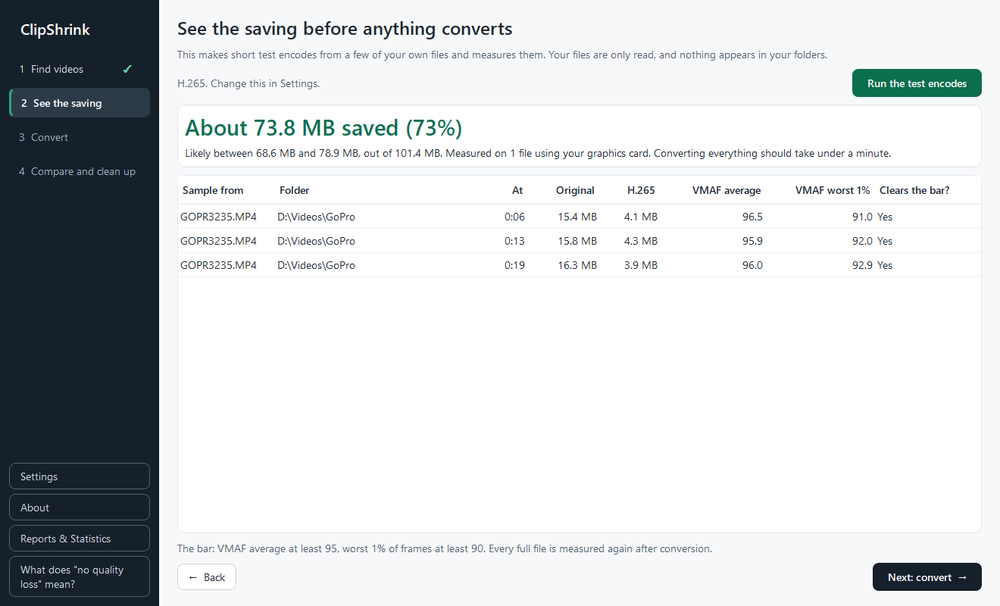

# See the saving

Step 2 tells you roughly how much space you would save, before a single file is converted. Your files are only read, and nothing appears in your folders.

## Run the test encodes

1. Optionally change the format, size or encoder in [Settings](settings-and-data.md). The estimate follows them.
2. Click **Run the test encodes**.

ClipShrink picks up to five of your ticked videos, spread across the different resolutions and frame rates in your selection, larger files first within each kind of footage. It cuts a few short pieces from each, converts them, and compares them with the originals. A progress bar shows how many of the files are done. The Convert step stays locked until an estimate exists, and changing **Speed** clears the estimate so you measure again.

## What the estimate shows

The card at the top gives the following (these are parts of the card, not separate labelled fields):

- **Saving**: "About *X* saved (*N*%)", for all the videos you ticked.
- **Range**: "Likely between *low* and *high*, out of *total*". It is a range because the test encodes only cover some of your files.
- **Measured on**: how many files were sampled, and whether your graphics card or your processor did the work.
- **Time**: "Converting everything should take *time*", shown as, for example, "under a minute", "about 12 minutes" or "about 3 h 20 min". It is a rough guide.

The saving counts the video itself. Sound and other tracks are not included, and the estimate never predicts that a file would grow.

## The sample table

Each row is one sample taken from one file:

| Column | Meaning |
| --- | --- |
| Sample from, Folder | The file the sample was cut from |
| At | Where in the video, as `m:ss` |
| Original, H.265 | Size of the sample before and after. The H.265 column shows the converted size in whichever format you chose. |
| VMAF average, VMAF worst 1% | VMAF is a quality score from 0 to 100 that rates how close the conversion looks to the original. The average covers all frames; the worst 1% shows the weakest moments. |
| Clears the bar? | `Yes`, or `⚠ No, would get a warning` |

!!! note "How the quality bar works"
    The bar is a VMAF average of at least 95 and a worst 1% of frames of at least 90. The note under the table says so, and adds that every full file is measured again after conversion. A "No" here is a preview: that file would still be converted, but with a warning sign you should look at. See [Warnings](warnings.md).

## How sure is it?

It is an estimate from real test encodes of your own footage, not a promise. The range is deliberately wide, and the real saving can still fall outside it. The more alike your files are, the closer it tends to be. The method is explained in [How estimation works](../internals/estimation.md).

## Next steps

- Happy with the numbers? Go to **Next: convert →** and read [Converting](converting.md).
- Want the details of the method? See [How estimation works](../internals/estimation.md).
