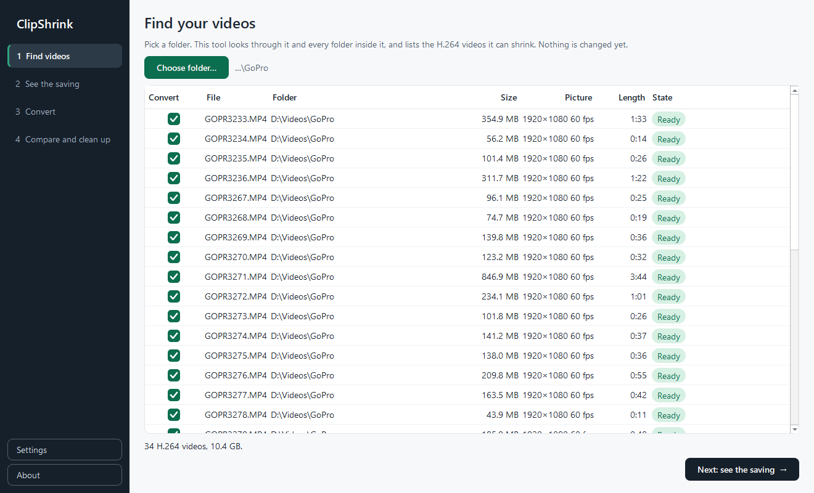

# Finding videos

Step 1 lists the videos ClipShrink can shrink. Nothing is changed yet.

## Choose a folder

Click **Choose folder…**. ClipShrink looks through that folder and every folder inside it, reading each video to find out its format. While it works you see "Reading your videos…".

It reads these file types, whatever the capitalisation: `.mp4`, `.mov`, `.m4v`, `.mkv`, `.avi`, `.lrv`, `.mts`, `.m2ts`, `.ts` and `.3gp`. Other files, such as photos or text files, are ignored and not listed. Symbolic links are not followed.

These folders are never entered: `$RECYCLE.BIN`, `System Volume Information`, `.tmp.drivedownload` and `.tmp.driveupload`. A folder Windows will not let ClipShrink open is skipped without a message.

## What the list shows

| Column | Meaning |
| --- | --- |
| Convert | Tick box. Click anywhere in the cell to toggle it. |
| File | File name |
| Folder | Where it lives |
| Size | File size |
| Picture | Resolution and frame rate, for example `1920×1080 30 fps` |
| Length | Duration as `m:ss` |
| State | `Ready`, or why the file is treated differently |

Click a column title to sort. The list keeps its original order until you do, and sizes sort by real size (900 MB comes before 1.2 GB).

## What is ticked, unticked or skipped

Only H.264 videos can be converted, and most are ticked for you.

| What you see in State | Ticked? | Why |
| --- | --- | --- |
| `Ready` | Yes | H.264 video not converted before |
| `GoPro low-res preview, off by default` | No | `.lrv` files are GoPro's low-resolution preview versions of clips. Tick them only if you want them shrunk too. See [GoPro LRV files](#gopro-lrv-files). |
| `Verified` or `⚠ Below the bar` | No | You already converted this file (same size), so it is not queued again by default. Other earlier results (such as `Original kept`) stay ticked. |
| `Already H.265, skipped` | Cannot be ticked | The video is already H.265. AV1 and other formats say so the same way. |
| `Already <CODEC>, skipped` | Cannot be ticked | Any other format, for example `Already VP9, skipped`. |

Skipped rows are greyed and show a dash instead of a tick box. If a skipped file is a conversion ClipShrink made earlier, the State ends with "(converted by this tool)". That is why your own `_(h265)` files show up as already H.265 and are not converted a second time.

Files that cannot be read at all are not listed as rows. They are counted in the note under the list, with the first three names.

That note sums things up: how many H.264 videos and how much space they take, how many are already H.265, and how many are in another format. If nothing convertible is found, it says so.

## Choose what to convert

Tick or untick any rows you like. **Next: see the saving →** stays disabled until at least one video is ticked.

!!! note
    ClipShrink does not skip small files. Any readable H.264 video in the folder is a candidate, whatever its size.

## Next steps

- [See the saving](estimates.md) before you convert anything.

## GoPro LRV files

An LRV file is a small, low-resolution copy that a GoPro records alongside each video, so the camera and its phone app can show quick previews. You don't need it if you have the original video.

When a scan finds LRV files with their original video beside them, a pop-up tells you how many there are and how much space they take, and asks whether to send them to the Recycle Bin:

- **Yes** sends them to the Recycle Bin and removes them from the list. Each one is checked again just before it goes.
- **No** changes nothing. They stay on the list, unticked.

A preview counts as having its original if a video of the same name is in the same folder: `GL010123.LRV` goes with `GH010123` or `GX010123`, and `GOPR0123.LRV` with `GOPR0123`. A conversion of that video, such as `GX010123_(h265).mp4`, also counts. An LRV file with no such video beside it is always kept, and if there are only files like that, no pop-up appears.
