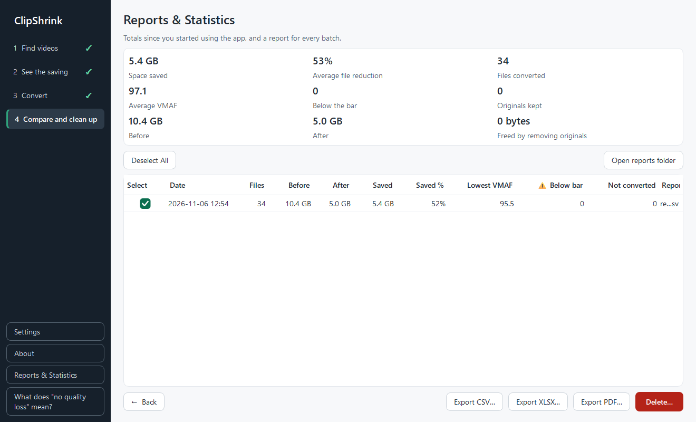

# Reports & Statistics

ClipShrink keeps a report for each batch and totals your savings across all of them. Open the **Reports & Statistics** page from the sidebar.



## What the automatic report contains

A report is written automatically while a batch runs. After each finished file, the batch's report is rewritten with every file finished so far in that run. If a report can't be written, the conversion carries on regardless.

- A batch where nothing finished writes no report.
- A report covers only the files finished in that run.

The report is a CSV file named `report_YYYY-MM-DD_HHMMSS.csv` (with `_2`, `_3` and so on if that name exists), with one row per file and these 13 columns:

| Column | Meaning |
|---|---|
| Date | When the file was processed |
| File, Folder | Which video |
| Result | For example "Verified", "⚠ Below the bar", "Original kept" |
| Reason | Why a file was kept or warned about |
| Before (bytes), After (bytes) | Sizes of the original and the conversion |
| Saved % | `1 - after / before`, to one decimal |
| VMAF average, VMAF worst 1% | The measured scores, to two decimals |
| Encoder, Quality setting | What was used |
| Conversion | Path of the converted file |

After, Saved % and Conversion are filled in only for files that were converted.

## Where reports are stored

```text
%LOCALAPPDATA%\ClipShrink\reports
```

Click **Open reports folder** to open it in Explorer. Reports stay on your PC.

## Statistics

The tiles at the top are computed from the app's own records, not from the report files, so they keep their values even if you delete reports:

- Space saved
- Average file reduction
- Files converted
- Average VMAF
- Below the bar
- Originals kept
- Before
- After
- Freed by removing originals

"Originals kept" counts files whose original was kept because the conversion was refused or failed. "Freed by removing originals" counts only originals you have sent to the Recycle Bin. "Average file reduction" is the average of each file's percentage, not weighted by size.

## The reports table

Reports are listed newest first with these columns: Select, Date, Files, Before, After, Saved, Saved %, Lowest VMAF, ⚠ Below bar, Not converted and Report file. A file that can't be read shows "Could not read".

## Export

Tick one or more reports, then click **Export CSV…**, **Export XLSX…** or **Export PDF…**, and choose a destination folder. Each export keeps the report's name with the new extension and never overwrites an existing file.

- **CSV** is a copy of the report.
- **XLSX** has one sheet, "Report", with numbers stored as numbers, a frozen header row and filters.
- **PDF** is an A4 landscape table of File, Folder, Result, Before (bytes), After (bytes), Saved %, VMAF average and VMAF worst 1%, with a heading and summary line.

## Delete a report

Tick the reports and click the red **Delete…** button. After you confirm "Delete reports?", they are sent to the Recycle Bin. Your videos and the statistics don't change.

## Next steps

- [Warnings and messages](warnings.md)
- [Settings and data](settings-and-data.md)
